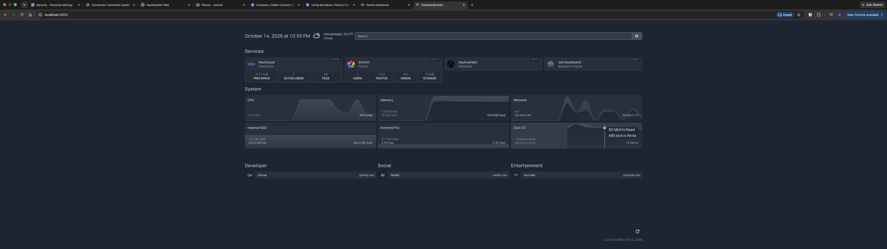
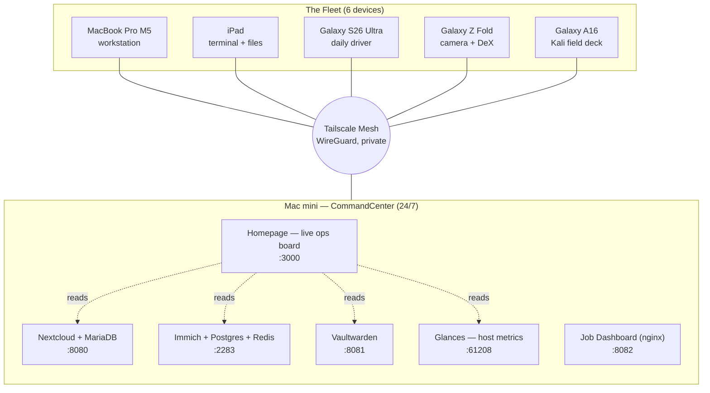

# Sovereign Homelab — CommandCenter




A self-hosted personal cloud and multi-device fleet, owned outright. No rented storage, no third-party clouds holding the data. One always-on server, reachable privately from anywhere, running the services a household actually uses — files, photos, passwords — plus a live operations dashboard that shows the whole stack breathing in real time.

Built as a reinvention project: turning tech from an interest into a working skill by designing, deploying, and operating real infrastructure end to end.

> **Why "sovereign"?** Every byte lives on hardware I own. Nothing is rented, nothing is hostage to a subscription, and the server is invisible to the open internet by design — reachable only across a private mesh.

---

## Architecture



**The model in one line:** every device joins a private Tailscale mesh; the Mac mini runs the services in Docker; nothing is exposed to the public internet. Tailscale off = the server doesn't exist. Tailscale on = instant, encrypted access from anywhere on Earth.

---

## The Fleet

| Device | Role |
|---|---|
| Mac mini (24 GB / 512 GB) | The server — "CommandCenter," on 24/7 |
| MacBook Pro M5 | Primary workstation, full two-way sync |
| iPad | One-tap terminal (Blink + Mosh + tmux) and file access |
| Galaxy S26 Ultra | Daily driver |
| Galaxy Z Fold | Main camera + DeX pocket workstation |
| Galaxy A16 | Mobile Kali / recon field deck |

## The Stack

| Service | What it does | Port |
|---|---|---|
| **Nextcloud** + MariaDB | Self-hosted files & sync (own Dropbox/Drive) | 8080 |
| **Immich** + Postgres + Redis | Self-hosted photo cloud, phone auto-backup | 2283 |
| **Vaultwarden** | Self-hosted Bitwarden password vault | 8081 |
| **Homepage** | Live operations dashboard (the "NOC wall") | 3000 |
| **Glances** | Host system metrics feed (CPU/mem/net/disk) | 61208 |
| Job Dashboard (nginx) | Static JSON-driven tracker | 8082 |

---

## Access & Security Model

- **Private by default.** All services sit behind [Tailscale](https://tailscale.com). There are no public ports, no exposed IPs. The attack surface from the open internet is zero.
- **HTTPS via Tailscale Serve** on the services that front it, so traffic is encrypted end to end even inside the mesh.
- **Secrets never live in this repo.** Every credential — DB passwords, API keys, app tokens — is stored in the self-hosted Vaultwarden vault, and excluded from version control via `.gitignore`. The committed configs are sanitized templates with placeholders.
- **Nightly backups** of the live data to a separate physical drive, scheduled with a macOS LaunchAgent.

---

## Repo Structure

```
sovereign-homelab/
├── README.md                     ← you are here
├── .gitignore                    ← blocks every secret file
├── docs/
│   ├── architecture.md           ← how the whole system fits together
│   ├── commandcenter.md          ← server reference & build log
│   ├── nextcloud.md
│   ├── immich.md
│   ├── dashboard.md              ← the Homepage ops board build
│   ├── remote-access.md          ← Tailscale + one-tap terminal
│   ├── backups.md
│   └── gotchas.md                ← lessons learned the hard way
├── nextcloud/                    ← compose + .env.example (sanitized)
├── immich/                       ← .env.example (uses official compose)
├── vaultwarden/
├── homepage/config/              ← the live dashboard config (keys blanked)
├── glances/                      ← the LaunchAgent that keeps metrics alive
└── scripts/                      ← backup + helpers (sanitized)
```

---

## Configure Before Deploying

Everything committed here is a **template**. Replace the placeholders with your own values:

| Placeholder | Meaning |
|---|---|
| `<TAILNET>` | your Tailscale tailnet name (e.g. `tailXXXXXX.ts.net`) |
| `<MINI_TS_IP>` | the server's Tailscale IP (`100.x.y.z`) |
| `<...PASSWORD>` / `<...KEY>` / `<...TOKEN>` | generate your own; store in a password manager, never commit |

Copy each `*.example` file to its real name (`cp .env.example .env`), fill in your values, and you're ready to `docker compose up -d`.

---

## Lessons Learned

Real build, real problems solved. See [`docs/gotchas.md`](docs/gotchas.md) for the full list — Docker credential-helper lockouts over SSH, APFS snapshot space traps, Nextcloud trusted-domain rejections, and more. This section is the proof the thing was actually built and debugged, not copied from a tutorial.

---

## Roadmap

- [x] Nextcloud + MariaDB (files)
- [x] Vaultwarden (passwords)
- [x] HTTPS via Tailscale Serve
- [x] Nightly backups to external drive
- [x] Immich (photos) + phone auto-backup
- [x] One-tap remote terminal (Mosh + tmux) across the fleet
- [x] Homepage live operations dashboard
- [ ] Immich folded into the nightly backup, then retire external photo cloud
- [ ] Dedicated dashboard panel (15" display, kiosk)
- [ ] Automation layer (device routines)

---

*Built from a notepad sketch to a running stack. Owned outright, operated daily.*
